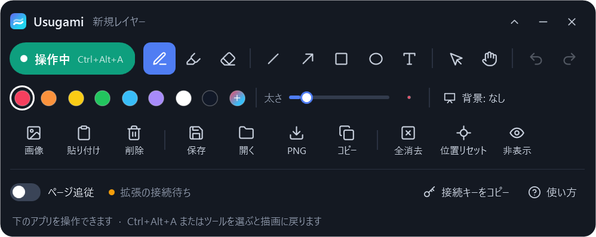

<div align="center">

# Usugami（うすがみ）

**画面の上に、薄紙を一枚。**  
Web ページやアプリの上に、ペン・図形・テキスト・画像で直接書き込める Windows 用の透明スクリーンレイヤーです。



</div>

---

## 主な特徴

- 🖊 **画面上のどこにでも書き込める** — ペン（筆圧感知対応）、蛍光ペン、直線・矢印・四角・楕円、テキスト入力、画像の貼り付けに対応
- 🖱 **書き込みを残したまま背面のアプリを操作** — `Ctrl + Alt + A` のショートカット一つで「描画モード」と「操作モード」を即座に切り替え可能
- 📜 **Web ページのスクロールに自動追従** — 付属のブラウザー拡張機能（Chrome / Edge）により、Web ページのスクロールに合わせて書き込みが連動
- 💾 **保存と多彩な書き出し** — 専用の `.usugami` 形式で保存していつでも再編集できるほか、透明背景 PNG での保存やクリップボードへの画像コピーにも対応
- 🪶 **インストール不要** — 単一の `Usugami.exe` だけで動作。Windows 10 / 11 標準の .NET Framework 4.8 のみを使用するため、追加ランタイムは一切不要

オンライン授業・プレゼンテーション・画面共有での解説、Web デザインや資料への赤入れ、操作マニュアルの作成などに最適です。

## 目次

- [はじめかた](#はじめかた)
- [基本の使い方](#基本の使い方)
- [ツール](#ツール)
- [ショートカット](#ショートカット)
- [Webページのスクロールに追従させる](#webページのスクロールに追従させる)
- [保存と書き出し](#保存と書き出し)
- [困ったときは](#困ったときは)
- [プライバシーとセキュリティ](#プライバシーとセキュリティ)
- [開発者向け](#開発者向け)
- [ライセンス](#ライセンス)

## はじめかた

1. [Releases](../../releases) から最新の `Usugami-windows.zip` をダウンロードして解凍します。
2. 解凍したフォルダー内の `Usugami.exe` を起動します。画面左上にツールバーが表示されます。

> **動作環境**：Windows 10 / 11（OS 標準搭載の .NET Framework 4.8 で動作します）
>
> **SmartScreen 警告について**：  
> コード署名を行っていないため、初回起動時に「Windows によって PC が保護されました」と表示される場合があります。安全を確認したうえで利用する場合は、「詳細情報」をクリックして「実行」を選択してください（配布ファイルの真正性は同梱の SHA-256 チェックサムで確認できるほか、[ソースコードからご自身でビルド](#ビルド)することも可能です）。

## 基本の使い方

| やりたいこと | 操作方法 |
| --- | --- |
| 画面に書き込む | ツールバーでペンや図形などのツールを選択（自動的に **描画モード** になります） |
| 背面のアプリを操作する | `Ctrl + Alt + A` を押すか、ツールバー左端の「描画中」ボタンをクリック → **操作モード** に切り替わり、書き込みを表示したまま背面を操作できます |
| 書き込みを再開する | 再度 `Ctrl + Alt + A` を押すか、ツールバーの描画ツールを選択 |
| 書き込みを一時的に隠す | `Ctrl + Alt + H`（もう一度押すと再表示されます） |
| アプリを終了する | ツールバー右上の「×」ボタン |

ツールバーは上部のタイトル部分をドラッグして自由に移動できます。右上の「︿」で2段目以降を折りたため、「―」をクリックすると細いミニバーに最小化できます（「﹀」で展開）。ツールバーの位置、選択中の色や線の太さは、次回起動時にも自動的に引き継がれます。

## ツール

| ツール | 説明と操作方法 |
| --- | --- |
| **ペン** | フリーハンドで描画。ペンタブレット等の筆圧感知に対応 |
| **蛍光ペン** | 半透明の太い線で対象をハイライト |
| **消しゴム** | なぞった線・図形・テキストを一筆・1オブジェクト単位で丸ごと消去（画像は選択して Delete） |
| **直線・矢印** | ドラッグして描画。`Shift` キーを押しながらドラッグすると角度を 45° 単位に固定 |
| **四角・楕円** | ドラッグして描画。`Shift` キーを押しながらドラッグすると正方形・正円を作成 |
| **テキスト** | クリックした位置に入力枠を作成。`Enter` で確定、`Shift + Enter` で改行、`Esc` でキャンセル。既存のテキストをクリックすると再編集可能 |
| **選択** | オブジェクトをクリックまたはドラッグで選択。位置の移動や右下のハンドルでの拡大・縮小が可能。テキストはダブルクリックで編集、選択中にカラーパレットを押すと色を変更 |
| **手のひら** | キャンバス全体をスクロール移動（マウスの中ボタンドラッグでも操作可能） |

- **カラーパレット**：8色の基本カラーと、自由な色を作成できる「＋」（カラーピッカー）を用意
- **太さスライダー**：スライダーでペン・図形の太さを調整。これから入力するテキストの文字サイズにも反映されます（入力済みのテキストは変わりません）
- **背景切り替え**：「透明（なし） → 半透明（暗め） → ホワイトボード（白）」の3段階。ホワイトボードに切り替えると背面の画面が隠れ、シンプルな図解用キャンバスとして利用できます

## ショートカット

**グローバルショートカット（どのアプリを操作中でも有効）**

| ショートカットキー | 動作 |
| --- | --- |
| `Ctrl + Alt + A` | 描画モード ↔ 操作モード の切り替え |
| `Ctrl + Alt + H` | 書き込みの表示 / 非表示 の切り替え |
| `Ctrl + Alt + Z` | 直前の操作を元に戻す（Undo） |
| `Ctrl + Alt + V` | クリップボード内の画像をキャンバスに貼り付け |

**描画モード時のみ有効なキー**（操作モード時は背面のアプリに直接キーが渡ります）

| ショートカットキー | 動作 |
| --- | --- |
| `Esc` | 選択を解除。何も選択されていない場合は操作モードへ切り替え |
| `Ctrl + Z` / `Ctrl + Y` | 元に戻す（Undo） / やり直す（Redo、`Ctrl + Shift + Z` も可） |
| `Delete` | 選択中のオブジェクトを削除 |
| `Ctrl + S` | 上書き保存 |

**キャンバスのスクロール・拡大縮小**（「ページ追従」が OFF のときに有効）

| 操作 | 動作 |
| --- | --- |
| マウスホイール / `Shift` + ホイール | 上下スクロール / 左右スクロール |
| `Ctrl` + マウスホイール | カーソル位置を中心に拡大・縮小（15% 〜 500%） |
| 「位置リセット」ボタン | スクロール位置と拡大率を初期状態（100%）にリセット |

## Webページのスクロールに追従させる

付属のブラウザー拡張機能を導入すると、Web ページをスクロールした際に、書き込みがページ内容に合わせて自然に追従します。

> **対応ブラウザー**：Google Chrome / Microsoft Edge（Chromium バージョン 102 以降）。セキュリティ更新が適用された最新版をご利用ください。

### 1. 拡張機能のインストール（初回のみ）

1. ブラウザーで拡張機能の管理画面を開きます。
   - Microsoft Edge: アドレスバーに `edge://extensions` と入力
   - Google Chrome: アドレスバーに `chrome://extensions` と入力
2. 画面上部または左側の **「デベロッパー モード（開発者モード）」** を ON にします。
3. **「パッケージ化されていない拡張機能を読み込む」**（Edge では「展開して読み込み」）をクリックし、zip 内に含まれる **`extension` フォルダー** を選択します。
4. すでに開いている Web ページがある場合は、そのページを一度再読み込み（F5）してください。

### 2. Usugami との接続設定（初回のみ）

1. Usugami のツールバーで **「接続キーをコピー」** をクリックします。
2. ブラウザー右上のツールバーから Usugami の拡張機能アイコンをクリックして開き、コピーした接続キーを貼り付けて **「保存して接続」** をクリックします。

※ 接続キーは PC やアプリを再起動しても保持されるため、毎回設定し直す必要はありません。

### 3. 日常の使い方

1. Usugami のツールバーで **「ページ追従」を ON** にします。
2. 画面上の Web ページに直接書き込みます。
3. `Ctrl + Alt + A` で「操作モード」に切り替えてページをスクロールすると、書き込みがページと一緒にスクロールします。

拡張機能アイコンのバッジで接続状態を確認できます。

| バッジ表示 | 状態 |
| --- | --- |
| `ON` | 正常に接続中 |
| `!` | Usugami が見つかりません（アプリが未起動、またはポート競合） |
| `KEY` | 接続キーが未設定、またはアプリ側のキーと一致していません |
| `ERR` | 拡張機能が接続キーを読み書きできません（ブラウザーを最新版に更新し、拡張機能を再読み込みしてください） |

<details>
<summary>追従機能の仕様と注意点</summary>

- **追従の対象**：ページ全体の縦横スクロールに対応しています。ページ内の一部のみが独立してスクロールする領域、`iframe`、PDF ビューアー、ブラウザー設定画面などは追従対象外です。
- **固定ヘッダー・フッター**：画面上部などに固定された要素（スクロールしても動かないヘッダー等）の上への書き込みは、ページスクロールに合わせて動くため位置がずれます。
- **単一キャンバス**：書き込みは 1 枚の共通キャンバスとして保持されます。ブラウザーのタブを切り替えても書き込み内容は自動では切り替わりません。ページごとに別々のメモを残したい場合は、ファイルとして保存して使い分けてください。
- **再読み込みや拡大率の変更**：ページの再読み込み、別 URL への遷移、ブラウザーの表示倍率変更、ウィンドウ移動を行った場合、書き込みの位置は自動では再調整されません。
- **追従中の拡大率**：ページ追従が有効な間は、キャンバスの拡大率が 100% に固定されます。
- **マルチモニター**：表示スケール（DPI）が異なるモニター間をウィンドウがまたぐ場合、位置合わせにわずかなズレが生じることがあります。

</details>

## 保存と書き出し

| ボタン | 動作 |
| --- | --- |
| **保存** | 現在のキャンバスを `.usugami` 形式で上書き保存（初回は保存ダイアログを表示。`Shift` + クリックで「名前を付けて保存」）。すべての描画ストローク・筆圧情報・図形・テキスト・画像・表示位置が保持され、貼り付けた画像もファイル内に安全に埋め込まれます |
| **開く** | 保存した `.usugami` ファイル（旧バージョンの `.layer` 形式にも対応）を開きます。`Usugami.exe` にファイルを直接ドラッグ＆ドロップして開くことも可能です |
| **PNG** | 書き込み全体を透明背景の PNG 画像として書き出します（背景を「暗く」にしている場合は半透明の黒、「ホワイトボード」の場合は白の背景が入ります） |
| **コピー** | 書き込み全体の画像をクリップボードにコピーします。そのままチャットツールやプレゼン資料、ドキュメントに貼り付けられます |

- **画像の追加**：ツールバーの「画像」ボタン（複数ファイル選択対応）、`Ctrl + Alt + V` でのクリップボード貼り付け、またはエクスプローラーから画像ファイルをコピーして貼り付けることで手軽に追加できます。そのまま追加すると文書の上限（下記）を超えて保存できなくなる大きな画像は、追加する時点で確認ダイアログが表示され、縮小して追加できます。
- **元に戻す / やり直しの履歴**：最大 100 件の操作履歴を保持します。「全消去」を行ってしまった場合でも直前の状態に復元可能です。
- **自動バックアップと復元**：未保存の編集内容は 1 分ごとにバックアップされます。不意のアプリ終了や Windows の突然の再起動が発生した場合でも、次回起動時に復元するかどうかを確認するダイアログが表示され、前回の作業状態を復元できます。`.usugami` ファイルをダブルクリックして起動した場合も、ファイルを開く前にこの確認が表示されます。バックアップに失敗した場合はツールバーと通知領域に警告が表示されるので、手動で保存してください（未保存のままアプリを終了しようとした際にも確認ダイアログが表示されます）。

### データ保護と上限値について

不正なファイルや過大な入力によるメモリ枯渇・クラッシュを防ぐため、以下の安全基準を設けています。

- **ファイルサイズ**：文書ファイルおよび貼り付け可能な画像ファイルは、それぞれ 1 ファイルあたり最大 64 MiB です（文書に埋め込まれた画像データも文書サイズに含まれます）。
- **文書構成の上限**：1 文書につき最大 20,000 項目、描画ストロークの累計頂点数 500,000 点、テキストは 1 項目あたり最大 10,000 文字（累計 500,000 文字まで、文字サイズ最大 4,000）。
- **画像の上限**：画像の解像度は一辺最大 20,000 px、単体画像および文書内の累計画素数は最大 1 億画素（100 メガピクセル）まで。

これらの上限を超える読み込みや保存が発生した場合は、エラーとして処理され、作業中のデータや既存の保存ファイルが破損・上書きされることはありません。

## 困ったときは

<details>
<summary>画面全体がクリックできなくなった（背面のアプリを操作できない）</summary>

現在 **描画モード** になっています。  
キーボードの `Esc` または `Ctrl + Alt + A` を押すことで **操作モード** に切り替わり、背面のウィンドウやアプリを通常通りクリック・操作できるようになります。

</details>

<details>
<summary>ツールバーが見当たらない / 画面外に消えてしまった</summary>

タスクトレイ（タスクバー右下の「∧」をクリックした中にある場合があります）の Usugami アイコンをクリックすると、ツールバーが前面に再表示されます。マルチモニターの接続を解除して画面外に出てしまった場合も、自動的にメインモニターの安全な位置へと復帰します。

</details>

<details>
<summary>ショートカットキーが動作しない</summary>

他の常駐ソフトウェアが同じショートカットキーを既に使用している場合、OS の制限によりキーの登録に失敗することがあります。登録できなかったキーは起動時にツールバー上に通知されます。ショートカットキーが使えない場合でも、ツールバーの各ボタンから同等の操作が可能です。

</details>

<details>
<summary>画面共有や録画ソフトに書き込みが映らない</summary>

Web 会議ツールや画面録画ソフトで共有する際は、「ウィンドウ共有」ではなく **「画面全体（デスクトップ全体）の共有」** を選択してください。特定のアプリウィンドウのみを共有対象に指定すると、別ウィンドウとして最前面に浮いている Usugami の描画レイヤーは共有映像に含まれません。  
※ 排他的フルスクリーンで動作する一部のゲーム画面などでは、最前面に表示できない場合があります。

</details>

<details>
<summary>ページ追従がうまく機能しない</summary>

以下の点をご確認ください：
- ブラウザーの拡張機能アイコンをクリックし、接続状態が「接続済み」になっているか確認してください。
- 拡張機能をインストール・更新（再読み込み）した直後は、開いていた Web ページを一度再読み込み（F5）する必要があります。拡張機能の状態が「待機中」のまま、Usugami のツールバーが「拡張の接続待ち」のままのときは、まずこれを試してください。
- Usugami 本体のツールバーで「ページ追従」が ON になっているか確認してください。
- 拡張機能のアイコンに `KEY` と表示されている場合、または Usugami のツールバーに「接続キーが不一致」と表示されている場合は、Usugami のツールバーで「接続キーをコピー」し、拡張機能の設定画面でキーを貼り付け直してください。

</details>

## プライバシーとセキュリティ

- **完全オフライン動作**：Usugami アプリ本体はインターネット通信を一切行いません。
- **必要最小限のローカル通信**：ブラウザー拡張機能が送信するデータは、**スクロール座標・表示倍率・一時的なページ識別 ID** のみに限定されています。訪問している Web ページの本文・URL・タイトル・画像データなどを送信することは一切ありません。また、送信先はお使いの PC 内部（`127.0.0.1:47831`）に限定されています。
- **最小特権の拡張機能設計**：ブラウザー拡張機能は、設定保存用の `storage` 権限、ローカル通信先へのアクセス権（`http://127.0.0.1:47831/*`）、およびスクロール検知用のコンテンツスクリプトのみを使用します。閲覧履歴やタブ管理（`tabs`）の権限は一切要求しません。
- **強固なローカル認証**：PC 内の通信は暗号論的乱数による接続キーで保護されており、悪意のある外部 Web サイト等からの要求は拒否されます。

セキュリティ設計の詳細や脆弱性の報告窓口については、[SECURITY.md](SECURITY.md) をご確認ください。

設定情報および接続キーは `%APPDATA%\Usugami\` に保存されます。アンインストールする際は、ダウンロードしたフォルダーおよび拡張機能を削除し、上記のフォルダーを削除するだけで完了します。

## 開発者向け

### ビルド

Windows に標準搭載されている C# コンパイラ（.NET Framework 4.x の `csc.exe`）を使用するため、Visual Studio や大きな SDK を別途インストールすることなくビルドが可能です。

PowerShell を起動し、以下のスクリプトを実行してください：

```powershell
powershell -ExecutionPolicy Bypass -File .\build.ps1            # dist\ に実行ファイルをビルド
powershell -ExecutionPolicy Bypass -File .\build.ps1 -Test      # ビルド + 全自動テストの実行
powershell -ExecutionPolicy Bypass -File .\build.ps1 -Package   # ビルド + テスト + 配布用 zip の作成
```

- アプリ本体、タスクトレイ、拡張機能で使用される各種アイコン画像はビルドスクリプト内で自動生成されます。
- 拡張機能の自動テストには、Node.js 22 以降のサポート中 LTS バージョンが必要です（CI 環境では Node.js 24 を使用しています。なお、Usugami アプリ本体の実行には Node.js は不要です）。
- 配布用の zip パッケージは全テストが成功した場合にのみ生成され、実行ファイル、拡張機能、ドキュメント類、ライセンス、ツールバー画像が同梱されます。同時にハッシュ検証用の `dist\Usugami-windows.zip.sha256` も生成されます。
- ダウンロードした配布 zip の完全性は、PowerShell から `Get-FileHash .\Usugami-windows.zip -Algorithm SHA256` を実行し、同梱の `.sha256` ファイルの内容と照合することで確認できます（※ チェックサムは転送エラーや改ざん検知のためのものであり、コード署名の代替ではありません）。

### GitHub での公開と運用

- `build.ps1 -Package` で生成された zip ファイルおよび `.sha256` ファイルを GitHub Releases に添付します。`dist/` や `obj/` フォルダー、個人の作業データや接続キーはコミットに含めません。
- リポジトリの [Private vulnerability reporting](https://docs.github.com/ja/code-security/security-advisories/guidance-on-reporting-and-writing/privately-reporting-a-security-vulnerability) を有効化し、脆弱性を非公開で受け付けられる体制を整えてください。
- GitHub Actions CI は最小限の読み取り権限（`contents: read`）で動作し、ビルド・テスト・パッケージ構成の検証を自動実行します。外部 Actions はコミット SHA で固定管理され、Dependabot による安全なアップデートが提案されます（※ CI から Releases への自動デプロイは行っていません）。

### テスト

- `dist\Usugami.exe --self-test` — 描画エンジン、ドキュメント保存形式の往復、ローカル通信の認証機構、不正データの拒否処理などを総合的に検証し、結果を `dist\self-test.txt` に出力します。
- `node tests/extension.test.cjs` — ブラウザー拡張機能のスクロール送信、タブおよびフレームの絞り込み、キー認証保護、入力値の検証処理をテストします。
- `tests/scroll-test.html` — ページ追従機能の手動動作確認用 Web ページです（ローカルの HTTP サーバー経由で開いてテストしてください）。

※ 通常の設定や復元データに影響を与えずに動作確認を行いたい場合は、起動プロセスの環境変数 `USUGAMI_DATA_DIR` にテスト用の独立したフォルダーの絶対パスを指定してください。設定および自動復元データがそのフォルダー内に隔離されて保存されます（Windows の既知のフォルダー API を直接使用しているため、単に環境変数 `APPDATA` を変更するだけでは隔離されません）。

### ディレクトリ構成

```text
src/Usugami.cs      アプリ本体のソースコード（WPF / C#。保守しやすい単一ファイル構成）
extension/          ブラウザー拡張機能のソースコード（Manifest V3 準拠）
tests/              拡張機能の単体テストコードおよび手動確認用 HTML ページ
build.ps1           ビルド・テスト・パッケージ化を行う統合スクリプト
app.manifest        高 DPI 対応や Windows 10/11 互換性を定義したマニフェストファイル
```

## ライセンス

[MIT License](LICENSE)
